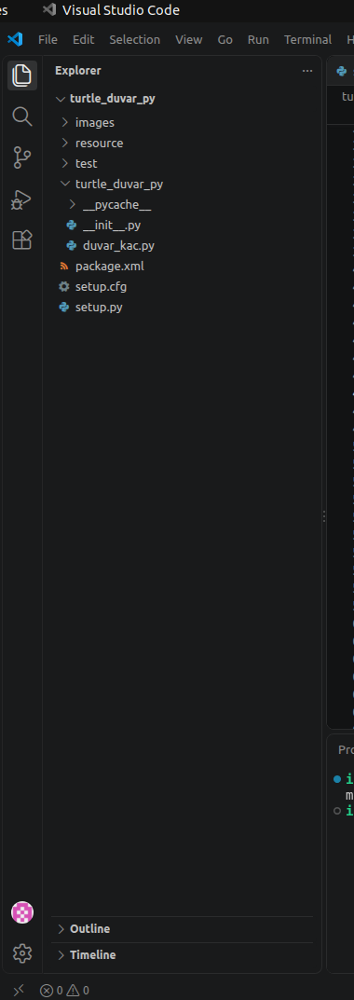
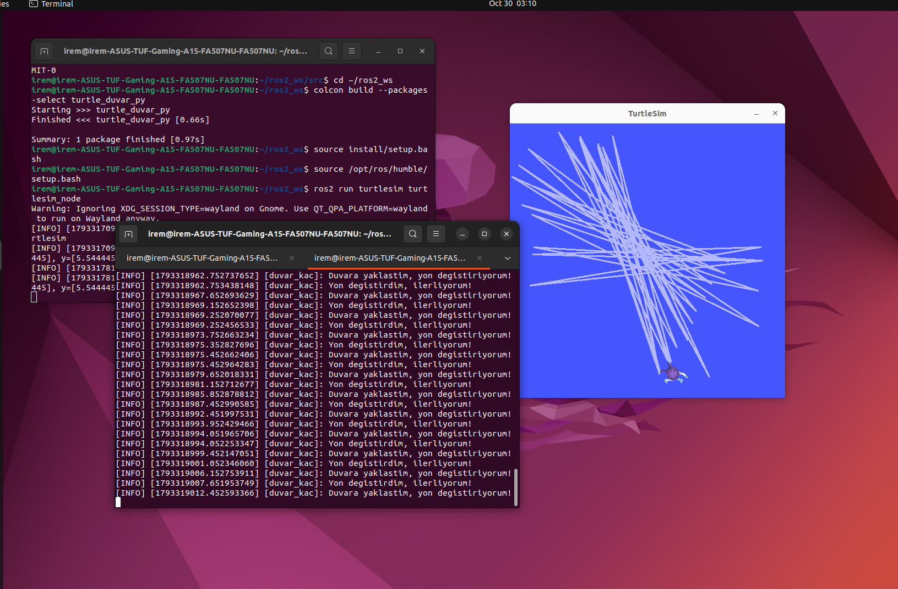

# Duvarlardan Kaçan Kaplumbağa - ROS 2

## 1. Projenin Amacı

Bu projede ROS 2 Humble ve Turtlesim kullanarak duvarlara yaklaşınca yön değiştiren bir kaplumbağa yaptım.

Kaplumbağa normalde ileri hareket ediyor. Duvara yaklaştığında yönünü değiştirerek tekrar ilerlemeye devam ediyor.

## 2. Kullanılan Teknolojiler

- Ubuntu
- ROS 2 Humble
- Python
- Turtlesim
- rclpy
- geometry_msgs

## 3. ROS 2 Paketinin Oluşturulması

İlk olarak çalışma alanının src klasörüne girdim.

```bash
cd ~/ros2_ws/src
```

Daha sonra gerekli bağımlılıklarla Python paketini oluşturdum.

```bash
ros2 pkg create turtle_duvar_py --build-type ament_python --dependencies rclpy geometry_msgs turtlesim
```



**Şekil 1.** Oluşturduğum ROS 2 paketinin VS Code üzerindeki klasör yapısı.

## 4. Python Kodunun Çalışma Mantığı

`turtle_duvar_py` klasörünün içine `duvar_kac.py` dosyasını oluşturdum.

Kodda iki temel ROS 2 konusu kullandım:

**Abone (Subscriber):**

`/turtle1/pose` konusunu dinleyerek kaplumbağanın x, y konumunu ve yön açısını aldım.

**Yayıncı (Publisher):**

`/turtle1/cmd_vel` konusuna `Twist` mesajı göndererek kaplumbağanın hareket etmesini sağladım.

Kaplumbağa x veya y konumunda belirlenen sınırlara yaklaştığında ekranın merkezine doğru dönüyor. Dönüş tamamlanınca tekrar ileri gidiyor.

## 5. Log Mesajları

Kaplumbağa duvara yaklaşınca terminale şu mesaj yazdırılıyor:

```text
Duvara yaklastim, yon degistiriyorum!
```

Yön değiştirme tamamlanınca:

```text
Yon degistirdim, ilerliyorum!
```

Bu mesajları `self.get_logger().info()` kullanarak yazdırdım.

## 6. Parametreler (Bonus)

Hız ve sınır değerlerini ROS 2 parametresi olarak tanımladım.

- `hiz`: Kaplumbağanın ileri hareket hızı. Varsayılan değer 2.0.
- `sinir`: Duvarlara yaklaşma sınırı. Varsayılan değer 1.0.

Bu değerler program çalıştırılırken değiştirilebilir.

## 7. Paketin Derlenmesi ve Çalıştırılması

Önce paketi derledim:

```bash
cd ~/ros2_ws
colcon build --packages-select turtle_duvar_py --symlink-install
source install/setup.bash
```

Birinci terminalde Turtlesim'i başlattım:

```bash
ros2 run turtlesim turtlesim_node
```

İkinci terminalde kendi düğümümü çalıştırdım:

```bash
cd ~/ros2_ws
source install/setup.bash
ros2 run turtle_duvar_py duvar_kac
```

Bonus parametreleri farklı değerlerle kullanmak için:

```bash
ros2 run turtle_duvar_py duvar_kac --ros-args -p hiz:=1.5 -p sinir:=1.2
```

## 8. Çalışma Sonucu

Program çalıştırıldığında kaplumbağa ileri hareket etti. Duvar sınırına yaklaştığında yönünü değiştirerek hareketine devam etti.

Terminalde de yön değiştirme mesajları görüntülendi.



**Şekil 2.** Turtlesim ortamında duvarlardan kaçan kaplumbağa ve terminaldeki log mesajları.

## 9. Sonuç

Bu ödevde ROS 2 kullanarak publisher, subscriber ve timer mantığını uyguladım.

Kaplumbağanın konumunu takip edip belirlediğim sınırlara göre hareket etmesini sağladım. Ayrıca log mesajları ve parametre kullanımıyla programı geliştirdim.